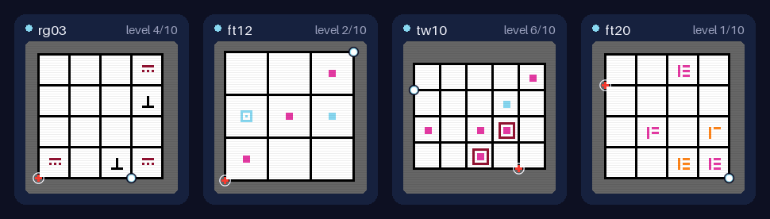
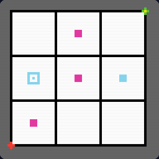

<div align="center">

<h1>WitnessBench</h1>

**Can an agent discover the rules of a game it has never seen, just by playing it?**<br>
Official code for *Witness: Discovery, Deciphering, and Epiphany in Interactive Puzzle Environments*

[](https://arxiv.org/abs/2609.32208) [](https://witnessbench.ai) [](pyproject.toml) [](LICENSE)

[Paper](https://arxiv.org/abs/2609.32208) · [Website](https://witnessbench.ai) · [Leaderboard](https://witnessbench.ai/#model-evals) · [Replays](https://witnessbench.ai/#demo) · [Play in your browser](https://witnessbench.ai/#play) · [Quick start](#-quick-start-no-model-or-api-key) · [Citation](#-citation)



<sub>Stored solutions of four training games, played on the real engine. The model reads the board as text and is never told the rule.</sub>

</div>

Each WitnessBench game is a grid line puzzle in the spirit of *The Witness*: draw a path from a start node to the end
node. Every game has hidden rules about the path or about the regions the path splits the board into. Agents are not
told the rules: they must discover them by playing, using only experiments and verbal reasoning (reflecting, adding
and deleting rule hypotheses, and planning).

```text
board as text → the model edits its rule guesses and writes a plan
              → the plan is played on the engine
              → new board
```

This repository holds the 35 public games (22 + 5 training, 8 validation), the *harness* (the text-only agent loop
every model plays through), the evaluators, and the reinforcement-learning (RL) code.

## News

- **2026-10:** 🎉 code release: the 35 public games, the harness, the evaluators and the RL training code.
- **2026-10:** 🏆 WitnessBench has joined Fireworks' [Specialized Intelligence Index (SII)](https://fireworks.ai/specialized-intelligence-index/ml-research/rule-discovery/witnessbench).
- **2026-09:** 📄 paper on [arXiv](https://arxiv.org/abs/2609.32208); leaderboard, replays and two playable demo games
  on [witnessbench.ai](https://witnessbench.ai).

##  The benchmark

| Split | Games | Levels per game | In this repo | Use it for |
|---|---|---|---|---|
| Training | 22 + 5 | 10 | yes,&nbsp;[`data/train.jsonl`](data/train.jsonl),<br>[`data/train_r2.jsonl`](data/train_r2.jsonl) | RL training |
| Validation | 8 | 5 | yes,&nbsp;[`data/val.jsonl`](data/val.jsonl) | checkpoint selection,<br>local evaluation |
| Private test | [on the leaderboard](https://witnessbench.ai/#model-evals) | 20 | **no** | the leaderboard only |

- Some validation games combine rules seen in training; the others test rules the training games do not use, with
  one exception described in the [training guide](docs/training.md#training-sets).
- Train on a training set, select checkpoints on the validation games, and have the maintainers run the test games
  for the [leaderboard](#-leaderboard). The rules of the 35 public games are listed in [docs/games.md](docs/games.md);
  the test games and their rules are not published.

## 🕹️ How an agent plays

An *episode* is one play of a game, starting at level 1. Whenever no planned action is left, the harness makes a
*reflection call*: it sends the model the board as text, what each action has done so far, the recent steps and
attempts, and the model's list of rule guesses.

The model edits that list (`<add>`, `<delete>`, `<keep/>`) and writes a `<plan>` of up to 16 actions: `0` RESET,
`1`-`4` move up, down, left and right, `5` CONFIRM (submit the path). The prompt explains RESET and CONFIRM but not
the moves; the model learns what each move does by trying it.

There is no conversation history, and every model plays through the same harness, so scores compare models, not
prompts. Each level allows 300 actions; if they run out before the level is solved, the episode ends.

The first prompt on a training game shows the board as on the right, with the colors listed below it; on the left
are the pixels, which the model never gets. Nothing in the prompt says what a gargoyle does
([prompt contents](docs/harness.md#the-observation)):

<table><tr>
<td></td>
<td>

```text
Legend: @=agent  E=end  Q=colored_square  g=gargoyles

Board:
   0 1 2 3 
 0       @
      Q   
 1        
    g Q Q 
 2        
    Q     
 3 E      

Color groups (cells sharing the same color):
  Squares of color 6: (0,1), (1,1), (2,0)
  Squares of color 10: (1,2)
  Gargoyles of color 10: (1,0)
```

</td>
</tr></table>

## 🚀 Quick start: no model or API key

Requires Python 3.12 or later (tested on 3.12, 3.13 and 3.14):

```bash
git clone https://github.com/fleet-ai/witnessbench.git
cd witnessbench

python3.12 -m venv .venv   # or any Python 3.12 or later
source .venv/bin/activate

pip install -e ".[test]"

pytest -q                  # 2955 passed, 8 skipped in a few minutes; no GPU, network or API key needed
```

`pip install -e ".[eval]"` installs only the games and evaluators. `WITNESS_SLOW_TESTS=1` runs the full suite,
including the eight skipped tests, in about 11 minutes.

Then play one level with a scripted policy. A *policy* is a function that takes the system prompt and the user message
of a reflection call and returns a reply; this one returns a fixed plan instead of calling a model:

```python
from pathlib import Path

from witness_agent import EpisodeLimits, run_episode, write_trace
from witness_env import make_game

def policy(system: str, user: str) -> str:
    return "<keep/>\n<plan>4,4,1,3,3,1,4,4,5</plan>"   # a fixed plan instead of a model

result = run_episode(make_game("tw01"), seed=0, policy=policy,
                     limits=EpisodeLimits(max_levels=1, max_reflection_calls=3))
print(result.levels_completed, result.stop_reason, len(result.calls))
write_trace(result, Path("trace_demo"))
```

It prints `1 max_levels 1`: one level completed, the episode stopped at its one-level limit, and it took one
reflection call. `trace_demo/` now holds every prompt and reply, every action and a summary
([trace format](docs/data-formats.md#episode-traces)).

To test your own model, make `policy` send the two messages to it and return its reply.

## 📊 Evaluate a model (validation)

```bash
# A model on OpenRouter. The key is read from the environment only, never written anywhere.
export OPENROUTER_API_KEY=...
python -m witness_agent.evaluate_api --model anthropic/claude-opus-5.5 --tasks data/val.jsonl \
    --out runs/opus55_val

# A model you serve yourself: run inside the training container (it has SGLang); serves HF_DIR on one GPU.
scripts/run_validation.sh HF_DIR runs/val
```

The OpenRouter evaluator sends requests only to providers with
[zero data retention](https://openrouter.ai/docs/guides/features/zdr), and its `--resume` option continues an
interrupted run.

In both evaluators, `--games` and `--seeds` run part of the task file. Both report the levels beaten per game and
seed. Every seed plays the same levels; a seed only fixes the random move the harness makes after a reply without a
valid plan.

The two evaluators differ in reasoning, output limit and default seeds, so compare models within one evaluator
([evaluation guide](docs/evaluation.md)).

## 🏋️ Train (WitnessGym)

*WitnessGym* is the paper's name for its RL training suite. It trains with *broadcast GRPO*: plain GRPO in which every
reflection call of an episode is trained with that episode's advantage.

It plugs into the open-source [miles](https://github.com/radixark/miles) trainer, used unmodified at commit
[`cd464a1c4`](https://github.com/radixark/miles/commit/cd464a1c4c91546ea43abb2233b97bc1bc90eb97). With this release,
a full run (30 steps on `data/train.jsonl`) takes about 45 hours for Qwen3.8-27B on one node of 8 B300 GPUs.

```bash
# Run inside the miles container.
python scripts/train.py --model 27b --run-name demo-27b
```

The recipe, the three training sets and checkpoint conversion are in [docs/training.md](docs/training.md).

## 🔬 Reproduce the transfer results

The paper tests whether RL on the training games transfers to four public benchmarks outside them: CipherBank,
PhysGym, WILT and Failing-to-Falsify. `transfer/` reruns that table for `Qwen/Qwen3.8-27B` and the RL checkpoint
[`WitnessGym-Qwen3.8-27B-RL-broadcast-step20`](https://huggingface.co/Guanghan-Ning/WitnessGym-Qwen3.8-27B-RL-broadcast-step20)
with the same code, settings and repetitions:

```bash
GPUS=0,1,2,3,4 OPENROUTER_API_KEY=sk-or-... bash transfer/reproduce.sh
```

It sets up the four benchmarks at pinned commits, downloads both models, evaluates each, and prints base vs. RL for
every benchmark: the paired difference and a 95% bootstrap interval. The OpenRouter key is for the API judges that
PhysGym and Failing-to-Falsify use. With 5 GPUs, one model takes about 12 hours.

The checkpoint is the state after 20 updates of broadcast GRPO on the 22 training games, trained with the paper's
harness v1. The paper's numbers are in its transfer table and in the model card.

Each benchmark needs small patches to run against a served model; none changes its tasks, prompts or scoring.
`transfer/setup.sh` stops unless every patched file matches the one that produced the paper's numbers. The settings,
the patches and how to evaluate your own checkpoint are in [transfer/README.md](transfer/README.md).

## 📚 Documentation

| I want to... | Start with | Guide |
|---|---|---|
| play a game in Python | `witness_env.make_game("tw01")` | [playing a game in Python](docs/games.md#playing-a-game-in-python) |
| bring my own model or agent | a `policy` function, as in the [quick start](#-quick-start-no-model-or-api-key) | [policies](docs/harness.md#policies) |
| use an OpenAI-compatible server as the policy | `witness_agent.http_policy.HttpPolicy` | [OpenAI-compatible endpoint](docs/harness.md#against-an-openai-compatible-endpoint) |
| evaluate a model on OpenRouter or one I serve | `witness_agent.evaluate_api`, `scripts/run_validation.sh` | [evaluation](docs/evaluation.md) |
| understand the scores | RHAE and OAE | [metrics](docs/evaluation.md#metrics) |
| run the game in another process | `witness_game` | [playing a game in another process](docs/harness.md#playing-a-game-in-another-process) |
| train a model with RL | `scripts/train.py` | [training](docs/training.md) |
| reproduce the transfer results | `transfer/reproduce.sh` | [transfer](transfer/README.md) |
| read traces, task files and evaluator outputs | `write_trace`, `data/*.jsonl`, `results.json` | [data formats](docs/data-formats.md) |
| find my way around the code | `witness_env/` games,<br>`witness_agent/` harness and evaluators,<br>`witness_game/` game client,<br>`witness_rl/` + `configs/` + `scripts/` training,<br>`tests/` | |
| get a model on the leaderboard | [open an issue](https://github.com/fleet-ai/witnessbench/issues/new?template=leaderboard-submission.yml) | [leaderboard](#-leaderboard) |

## 🏆 Leaderboard

Results, with replays of recorded runs, are on [witnessbench.ai](https://witnessbench.ai/#model-evals). The test games
are not public, so the maintainers run them: to have a model or agent evaluated,
[open an issue](https://github.com/fleet-ai/witnessbench/issues/new?template=leaderboard-submission.yml).

This release's harness (v2) describes the board more completely than the one the paper used (v1), so its scores are
not directly comparable with the paper's.

## 📝 Citation

```bibtex
@article{ning2026witness,
  title         = {Witness: Discovery, Deciphering, and Epiphany in Interactive Puzzle Environments},
  author        = {Ning, Guanghan and Liu, Ping and Li, Linyi and Zheng, Huangjie and Neervannan, Arjun and Nguyen, Huu and Sklar, Michael and Zorlu, Deniz and Ouporov, Nicolai},
  journal       = {arXiv preprint arXiv:2609.32208},
  year          = {2026},
  eprint        = {2609.32208},
  archivePrefix = {arXiv},
  primaryClass  = {cs.AI},
  doi           = {10.48550/arXiv.2609.32208},
  url           = {https://arxiv.org/abs/2609.32208}
}
```

## 🙏 Acknowledgments

- The games run on [arcengine](https://pypi.org/project/arcengine/) by the ARC Prize Foundation; RHAE is from ARC-AGI-3.
- Training uses [miles](https://github.com/radixark/miles) and [SGLang](https://github.com/sgl-project/sglang); frontier
  models are evaluated through [OpenRouter](https://openrouter.ai). We thank the human players who set the baselines.
- The games are inspired by the line puzzles of *The Witness* (2016). WitnessBench is an independent research
  project and is not affiliated with or endorsed by the developers of *The Witness*.

## ⚖️ License

The code is released under the MIT License (see [LICENSE](LICENSE)). Third-party software, including arcengine
(MIT) and miles (Apache-2.0), is installed separately under its own license; see
[THIRD_PARTY_NOTICES.md](THIRD_PARTY_NOTICES.md).
